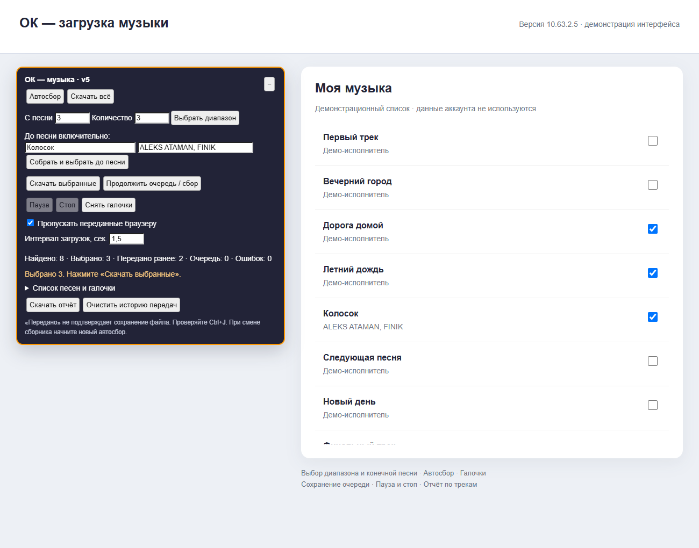

# ОК — загрузка музыки

Пользовательский скрипт для выбора и пакетного скачивания музыки из «Одноклассников» через OrangeMonkey. Версия **10.63.2.5**, на основе SaveFrom.net Helper 10.63.2.



На скриншоте — настоящий интерфейс скрипта с демонстрационными данными, не аккаунт пользователя.

## Установка

1. Скачайте файл [savefrom-ok-batch.user.js](savefrom-ok-batch.user.js) через **Download raw file**.
2. Замените предыдущую локальную версию в OrangeMonkey. Не оставляйте одновременно включёнными два SaveFrom.
3. Обновите страницу музыки ОК. Внизу слева появится панель **«ОК — музыка · v5»**.

Для приватного репозитория скачивайте файл после входа в GitHub. Автообновление скрипта отключено: новая версия устанавливается вручную.

## Возможности

- Автопрокрутка и накопление песен, даже когда сайт убирает старые строки из разметки.
- «Скачать всё», выбор диапазона и галочки возле песен или в собранном списке.
- Выбор до заданной песни включительно. Для примера заполнены «Колосок» и ALEKS ATAMAN, FINIK; поля можно изменить.
- Пропуск повторов по истории передач этой версии.
- Пауза, остановка и продолжение очереди или сбора после перезагрузки страницы.
- Настраиваемый интервал между передачами: 0,5–60 секунд.
- JSON-отчёт о списке, очереди, передачах и ошибках конкретных песен.

## Скачать до определённой песни

Укажите номер начальной песни, название конечной песни и исполнителя. Нажмите **«Собрать и выбрать до песни»**, дождитесь обнаружения, затем **«Скачать выбранные»**. Конечная песня включается в выбор. При нескольких совпадениях выбирается первое. Если песня не найдена, загрузка не запускается.

## Поведение и ограничения

- **«Передано браузеру» не означает подтверждённое сохранение.** OrangeMonkey не поддержал события `GM_download`; используется проверенный в пользовательской сессии вызов без обработчиков. Завершение проверяется через **Ctrl+J**.
- История старых версий не импортируется: они не сохраняли её. Пропуск повторов начинает работать с передач новой версии. Если файл не сохранился, снимите флажок пропуска и выберите его повторно.
- Состояние хранится в хранилище менеджера скриптов отдельно по адресу страницы. Прямые аудиоссылки не сохраняются. Если перезагрузка пришлась на передачу файла, неопределённая запись отражается в отчёте и пропускается как повтор до проверки пользователем.
- Автосбор останавливается после восьми секунд без новых строк внизу списка. Это эвристика: число найденных песен следует сравнить со счётчиком ОК. Не меняйте сборник и сортировку во время работы.
- Пауза и стоп прекращают новые передачи, но не отменяют файлы, уже отправленные Chrome.
- Загрузка первых трёх MP3 через OrangeMonkey была подтверждена пользователем на предыдущей версии. Для v5 выполнены автоматические проверки; полный запуск всех новых функций на реальном аккаунте не подтверждён.

Подробная инструкция: [ИНСТРУКЦИЯ.txt](ИНСТРУКЦИЯ.txt).

## Разработка и проверка

Требуется Node.js **24** и npm.

```sh
npm ci
npm test
npm run build
node --check savefrom-ok-batch.user.js
```

`batch-panel-v5.js` — текущая панель. `build.cjs` вставляет её в сохранённый оригинал SaveFrom. `batch-panel.js` и `test.cjs` оставлены для проверок предыдущего накопителя. `test-v5.cjs` моделирует виртуальный список и API менеджера скриптов: конечную песню, галочки, автосбор, повторы, паузу/стоп, восстановление, таймауты и ошибки по песням.

Скриншот создаётся командой `npm run screenshot`. Нужен установленный Chrome или Chromium Playwright (`npx playwright install chromium`).

## Происхождение

Основа: [SaveFrom.net Helper](https://download.sf-helper.com/chrome/helper.user.js), автор в метаданных — Itproductdev Ltd, версия 10.63.2 от 2026-11-02. Репозиторий содержит сохранённый оригинал, локальные изменения, сборщик, тесты и собранный скрипт. Атрибуция оригинала сохранена; лицензия на сторонний код здесь не переопределяется. Это независимая модификация, не официальный выпуск SaveFrom или ОК.
